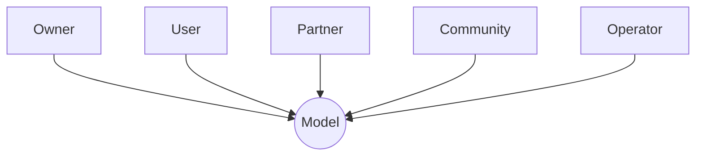
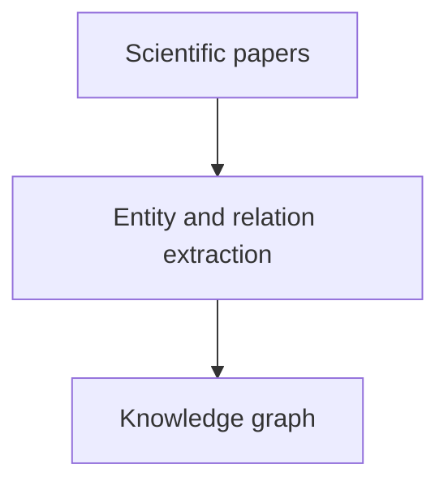
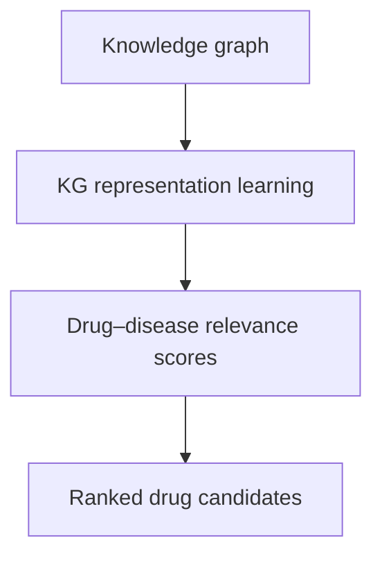

# 1. AI development lifecycle

# 2. Security in AI

### Data poisoning
> Data poisoning happens when an attacker intentionally modifies or injects malicious data into a training dataset to influence the model's behavior.

There are two important categories:
- **Availability poisoning**: Degrades overall model performance.
- **Targeted poisoning**: Causes specific inputs or situations to produce attacker-desired predictions.

### Backdoor attacks
> A backdoor attack is a special type of poisoning attack in which an attacker trains a model to behave normally under ordinary conditions but behave maliciously when a specific trigger appears.

### Model extraction and model theft
> An attacker attempts to reconstruct or approximate a proprietary model by querying its API and observing the outputs.

### Model inversion and membership inference
> These attacks attempt to extract sensitive information from a trained model.
> **Inversion**: An attacker uses model outputs to infer information about training data.
> **Membership**: An attacker tries to determine whether a particular record was included in the model's training dataset.

### Model supply-chain attacks
> AI models depend on many external components:
> - Pretrained models.
> - Open-source datasets.
> - Python packages.
> - Training frameworks.
> - Third-party plugins.
> - Model repositories.
> 
> An attacker may compromise one of these dependencies.

# 3. Poisoning Scientific Knowledge Using Large Language Models

## A. Overview
> The authors introduce Scorpius, a conditional text-generation framework that creates a malicious abstract around a selected drug--disease relationship.
>
> It demonstrates a vulnerability in a computational knowledge-discovery pipeline: fabricated evidence can influence extracted graph structure, learned representations, and downstream rankings.

## B. The Problem: How Scientific Knowledge Graphs Are Built
> Biomedical knowledge graphs are used to organize facts extracted from scientific literature. Typical entities include:
> - Drugs
> - Diseases
> - Genes

A typical KG-based scientific discovery pipeline has two stages.

**Stage 1**: Knowledge graph construction
> A collection of scientific papers is processed by relation-extraction systems. The systems identify entities and relations in the text and convert them into graph edges.

**Stage 2**: Knowledge graph reasoning
> A KG reasoning model learns vector representations (embeddings) for entities and relations. It uses these representations to estimate the plausibility or relevance of relationships, including drug--disease relationships that are not explicitly present in the graph.

**The pipeline therefore has two potential attack surfaces:**
1. **KG construction**: Can a malicious abstract cause a relation-extraction system to create a false edge?
2. **KG reasoning**: If a false edge is inserted, can it substantially alter the scores or rankings produced by the reasoning model?

## C. 
