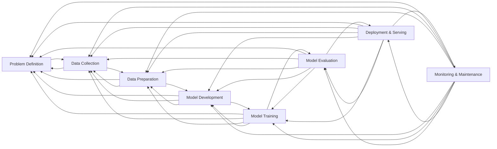

# 1. AI development lifecycle

1. **Problem Definition**:	Xác định bài toán, mục tiêu, yêu cầu
2. **Data Collection**:	Thu thập dữ liệu từ các nguồn
3. **Data Preparation**:	Làm sạch, xử lý, labeling, validation
4. **Model Development**:	Chọn kiến trúc, xây dựng model
5. **Model Training**:	Huấn luyện và tối ưu model
6. **Model Evaluation**:	Đánh giá hiệu năng của model
7. **Deployment & Serving**:	Đóng gói và triển khai model
8. **Monitoring & Maintenance**:	Giám sát, phản hồi

# 2. Security in AI

# 3. Usecase: Data Poisoning
