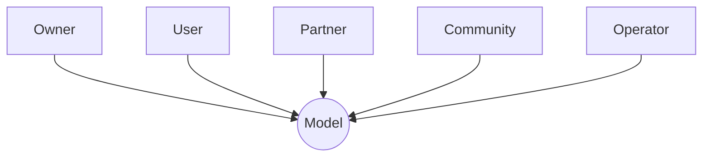

# 1. AI development lifecycle

# 2. Security in AI

### Data poisoning
> Data poisoning happens when an attacker intentionally modifies or injects malicious data into a training dataset to influence the model's behavior.

There are two important categories:
- **Availability poisoning**: Degrades overall model performance.
- **Targeted poisoning**: Causes specific inputs or situations to produce attacker-desired predictions.

### Backdoor attacks
> A backdoor attack is a special type of poisoning attack in which an attacker trains a model to behave normally under ordinary conditions but behave maliciously when a specific trigger appears.

### Model extraction and model theft
> An attacker attempts to reconstruct or approximate a proprietary model by querying its API and observing the outputs.

### Model inversion and membership inference
> These attacks attempt to extract sensitive information from a trained model.
> **Inversion**: An attacker uses model outputs to infer information about training data.
> **Membership**: An attacker tries to determine whether a particular record was included in the model's training dataset.

### Model supply-chain attacks
> AI models depend on many external components:
> - Pretrained models.
> - Open-source datasets.
> - Python packages.
> - Training frameworks.
> - Third-party plugins.
> - Model repositories.
> - 
> An attacker may compromise one of these dependencies.

# 3. Usecase: Data Poisoning
