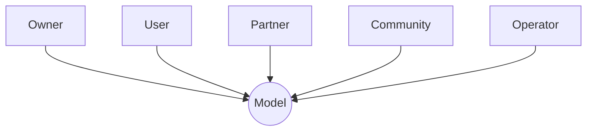
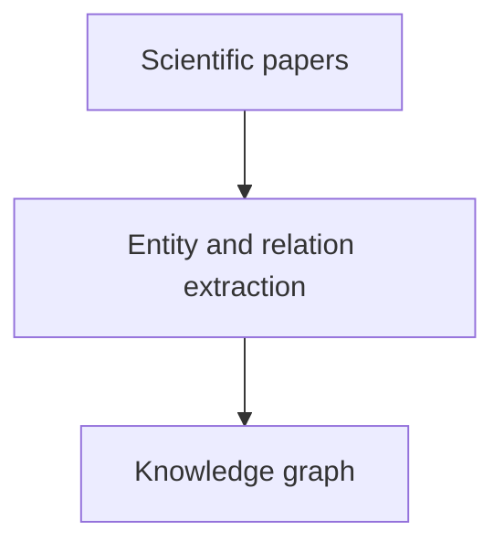
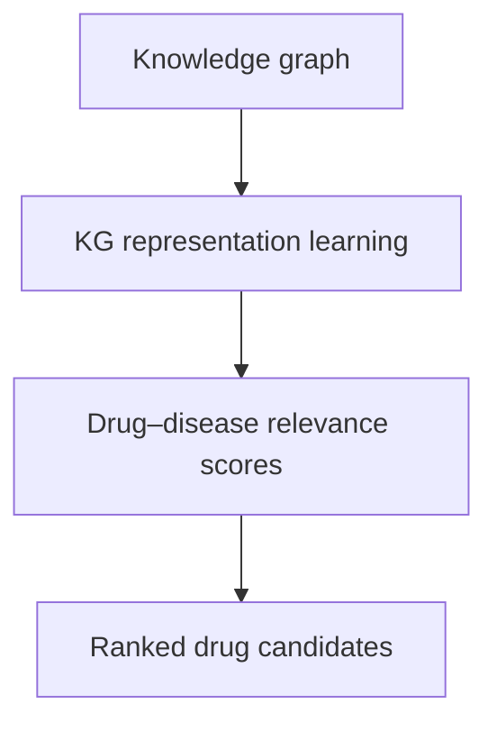
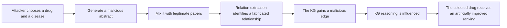
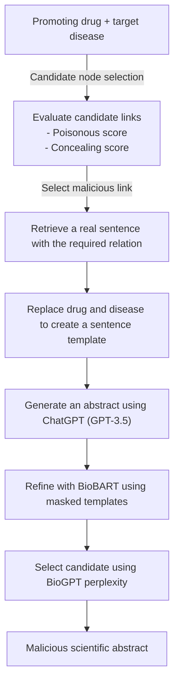
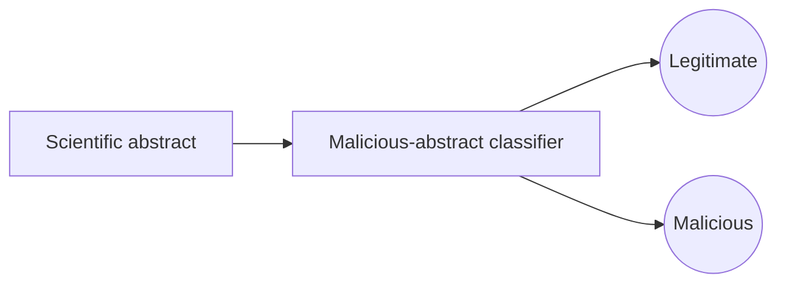

# 1. AI development lifecycle

# 2. Security in AI

### Data poisoning
> Data poisoning happens when an attacker intentionally modifies or injects malicious data into a training dataset to influence the model's behavior.

There are two important categories:
- **Availability poisoning**: Degrades overall model performance.
- **Targeted poisoning**: Causes specific inputs or situations to produce attacker-desired predictions.

### Backdoor attacks
> A backdoor attack is a special type of poisoning attack in which an attacker trains a model to behave normally under ordinary conditions but behave maliciously when a specific trigger appears.

### Model extraction and model theft
> An attacker attempts to reconstruct or approximate a proprietary model by querying its API and observing the outputs.

### Model inversion and membership inference
> These attacks attempt to extract sensitive information from a trained model.
> **Inversion**: An attacker uses model outputs to infer information about training data.
> **Membership**: An attacker tries to determine whether a particular record was included in the model's training dataset.

### Model supply-chain attacks
> AI models depend on many external components:
> - Pretrained models.
> - Open-source datasets.
> - Python packages.
> - Training frameworks.
> - Third-party plugins.
> - Model repositories.
> 
> An attacker may compromise one of these dependencies.

# 3. Poisoning Scientific Knowledge Using Large Language Models

## A. Overview
> The authors introduce Scorpius, a conditional text-generation framework that creates a malicious abstract around a selected drug--disease relationship.
>
> It demonstrates a vulnerability in a computational knowledge-discovery pipeline: fabricated evidence can influence extracted graph structure, learned representations, and downstream rankings.

## B. The Problem: How Scientific Knowledge Graphs Are Built
> Biomedical knowledge graphs are used to organize facts extracted from scientific literature. Typical entities include:
> - Drugs
> - Diseases
> - Genes

A typical KG-based scientific discovery pipeline has two stages.

**Stage 1**: Knowledge graph construction
> A collection of scientific papers is processed by relation-extraction systems. The systems identify entities and relations in the text and convert them into graph edges.

**Stage 2**: Knowledge graph reasoning
> A KG reasoning model learns vector representations (embeddings) for entities and relations. It uses these representations to estimate the plausibility or relevance of relationships, including drug--disease relationships that are not explicitly present in the graph.

**The pipeline therefore has two potential attack surfaces:**
1. **KG construction**: Can a malicious abstract cause a relation-extraction system to create a false edge?
2. **KG reasoning**: If a false edge is inserted, can it substantially alter the scores or rankings produced by the reasoning model?

## C. Threat Model
> The attacker wants a selected drug (the promoting drug) to appear more relevant to a selected disease (the target disease) than it should.
>
> The attacker does not directly modify the KG, its extraction model, or its reasoning model. Instead, the attacker creates a scientific-looking abstract and relies on the normal literature-ingestion process to introduce the abstract into the corpus.

> This is a data poisoning attack. The poisoned input is a document in the source corpus; the attack takes effect when the normal pipeline processes that document.

**Two attack settings**:
- **Disease-specific**: Promoting drug + target. Increase the relevance disease of one drug to one target disease
- **Disease-agnostic**: Promoting drug. Increase the relevance of one drug across diseases

## D. Vulnerability of KG Reasoning
> Before developing Scorpius, the authors test whether KG reasoning models are sensitive to the addition of a malicious edge.

**Experimental KG:**
- The KG was constructed from 3,818,528 scientific papers and contained:
  | Entity type | Number of entities |
  |------|------------|
  | Drugs | 16,468 |
  | Diseases | 5,379 |
  | Genes | 38,080 |

- The authors evaluate three KG reasoning approaches:
  - DistMult
  - ConvE
  - ComplEx
- They compare drug rankings before and after adding a malicious drug--disease link.
  | Setting | Action | Result |
  |------|------|------------|
  | Disease-specific results | adding one malicious link | Top 1: 0,3% -> 48,2%   Top 10: 1,9% -> 64,3%|
  | Disease-agnostic | add one, two, or three malicious links and measure how the promoting drug's relevance changes across diseases | - Adding more malicious links generally increases the drug's relevance.   The effect continues to increase as additional links are added.   - The increase begins to converge at around ten links.   - Some drugs can reach a top-10 ranking after only four malicious links in the reported experiment. |

> The authors also observe that some disease nodes are selected repeatedly. These highly connected nodes act as hub nodes: connecting a drug to a hub can influence its relevance to many other diseases.

## E. Vulnerability of KG Construction
> The authors randomly sample 2,000 drug--disease pairs that are not connected in the KG. For each pair, they attempt to create an abstract that will cause the extraction pipeline to produce the desired link.

**Replacement-based approach**: The initial approach starts from a real scientific abstract
1. Randomly select a real abstract.
2. Replace the original drug and disease with the promoting drug and target disease.
3. Randomly mask a proportion of words.
4. Use a biomedical language model to fill the masked words.
5. Run relation extraction and check whether the desired drug--disease link is recovered.

> The study evaluates several relation-extraction approaches, including GNBR, UIE, TDERR, and LUKE.

**Result**:
- At least 30% of sampled pairs can be poisoned under the tested replacement settings.
- A poisoning rate of at least 20% remains possible even when 60% of the words are randomly replaced.
- The generated text can be unnatural, which motivates a more controlled generation method.

## F. Scorpius: The Proposed Poisoning Framework
- Scorpius is designed to generate an abstract that satisfies two competing goals:
  - **Effectiveness**: The abstract should introduce a relationship that strongly changes the target drug's ranking.
  - **Concealment**: The abstract should be less likely to be identified as malicious or rejected by the data-processing pipeline.
- The framework has two major components:
  - Malicious-link selection
  - Malicious-abstract generation
 
### a. Malicious-link selection
> Given a promoting drug and, for the disease-specific setting, a target disease, Scorpius identifies candidate nodes around the selected entities and evaluates candidate links using two scores.

**Poisonous score**:
> The poisonous score estimates how much a candidate malicious link can influence KG reasoning and improve the promoting drug's ranking.

> A high poisonous score means that the link is expected to have a strong downstream effect.

**Concealing score**:
> The concealing score estimates how suitable a candidate link is for being hidden among legitimate relationships. It favors links that are less likely to be detected or excluded by the defender.

> Scorpius combines the poisonous and concealing scores to select a target malicious link.
> 
> The important design idea is that the most influential link is not necessarily the best attack choice if it is also easy to detect. Scorpius balances impact with concealment.

### b. Malicious abstract generation
> After selecting a target link, Scorpius generates text intended to make the relation extractor recover that link.
>
> The generation process combines real scientific sentence structures, ChatGPT, and biomedical language models.

**Step 1: Build a sentence template**
> Scorpius finds a real scientific sentence that has been used to identify the same relation type. It replaces the original drug and disease with the promoting drug and target disease.
>
> This creates a sentence template that preserves a relation pattern known to work with the extraction system.

**Step 2: Generate an abstract using ChatGPT**

> The paper uses the gpt-3.5-turbo API to expand the template into a biomedical abstract.
>
> ChatGPT is instructed to generate a scientific-style abstract while retaining the target sentence.
>
> However, the authors identify limitations in using ChatGPT output directly:
> - It may not strictly preserve the required sentence or phrases.
> - General-purpose generation may not consistently match biomedical writing conventions.
> - API rate limits can make repeated generation slower.

**Step 3: Refine the generation with BioBART**
> Scorpius uses the biomedical-domain model BioBART to refine the generated text.
>
> The paper describes two refinement strategies:
> - Replace the context in the ChatGPT-generated abstract with a masked sentence template.
> - Replace the ChatGPT generation with the original template, randomly mask nearby words, and use BioBART to fill the masks.
>
> These strategies help preserve the desired relation while allowing the surrounding text to be rewritten.

**Step 4: Select the generation using perplexity**

> Scorpius generates candidate abstracts and uses BioGPT perplexity to select the candidate with the lowest perplexity.
>
> Perplexity measures how well a language model predicts a sequence of tokens. In this context, lower perplexity is used as a proxy for text that is more likely under a biomedical language model.
>
> Important qualification: lower perplexity does not establish scientific correctness, truthfulness, or safety. It is a fluency / language-likelihood signal, not a fact-checking mechanism.

## G. Scorpius Evaluation

## H. Defense: Detecting Malicious Scientific Abstracts
The paper also develops a defender formulated as a binary classifier:

## I. Main Contributions
> The paper makes four main contributions.
>
> - Introduces scientific knowledge poisoning as a problem. It studies how LLM-generated malicious scientific text can manipulate knowledge graphs and downstream applications.
> - Demonstrates vulnerabilities in both KG stages. The experiments show that relation extraction can introduce malicious links and that KG reasoning can amplify their effects.
> - Proposes Scorpius. The framework combines impact-aware link selection with controlled biomedical abstract generation.
> - Studies a defender. The paper formulates malicious-abstract detection as a classification problem and demonstrates the trade-off between detecting attacks and preserving legitimate knowledge.

## J. Limitations and Caveats
- **Evaluation uses peer-reviewed articles**

> The experiments are performed using peer-reviewed articles. The authors note that preprints may be more vulnerable because they are less likely to have undergone the same level of editorial and peer review.
>
> They propose investigating poisoning in preprint-based collections in future work.

- **Defense can reject legitimate knowledge**

> The current defender can identify malicious links under the high defensive setting, but it may also reject many real links. The authors propose improving the defender with a supervised classifier.

- **Publication time is not modeled**

> The framework does not incorporate each paper's publication timestamp. The authors suggest that emerging and highly visible topics may be more attractive targets and propose incorporating time information in future work.

- **Perplexity is not a truth metric**

> The use of BioGPT perplexity is a text-likelihood measure. It does not verify whether the scientific claims are supported by experiments, whether the cited evidence exists, or whether the proposed drug--disease relationship is biologically valid.

- **Ranking changes are not biological validation**

> A drug moving up a KG-based ranking does not demonstrate clinical efficacy, therapeutic benefit, or a causal biological relationship. The experiments evaluate manipulation of a computational ranking pipeline.

- **Scope of the evidence**

> The paper is a proof-of-concept study using a particular biomedical KG, extraction methods, and reasoning models. The reported numbers should not be generalized automatically to all scientific KGs or production knowledge-discovery systems.
