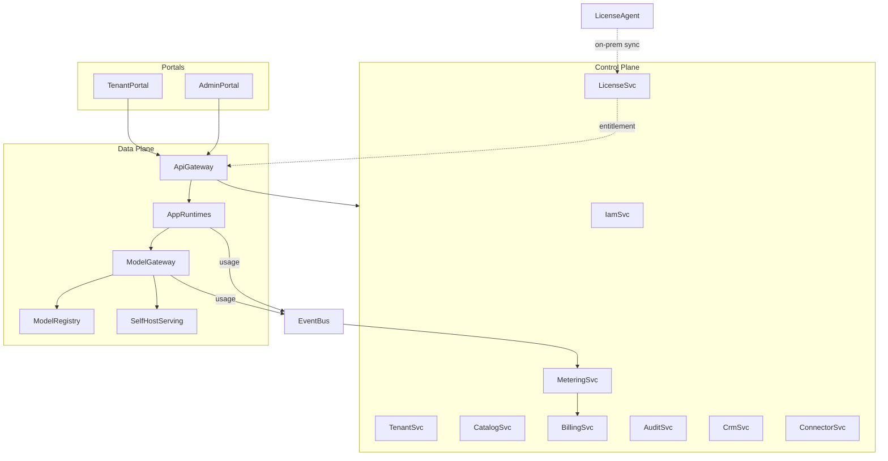

# 1. Context

# 2. Container

| Service | Plane | Feature | Trách nhiệm |
|---|---|---|---|
| `tenant-svc` | control | F01 | Tenant, Tenant Directory (tier, cell routing) |
| `iam-svc` | control | F02 | Auth, MFA, RBAC, API key, service account |
| `catalog-svc` | control | F03 | App catalog, provisioning/deprovisioning theo tenant |
| `license-svc` | control | F04 | Plan, subscription, AppLicense, entitlement, license file on-prem |
| `metering-svc` | control | F05 | Ingest usage event, aggregate, quota counter |
| `billing-svc` | control | F06 | Rating, invoice, payment, công nợ |
| `audit-svc` | control | F08 | Audit log bất biến, consent, retention |
| `crm-svc` | control | F09 | Contact, account, product catalog, timeline |
| `connector-svc` | control | F10 | Đồng bộ CRM/ERP ngoài |
| `admin-portal`, `tenant-portal` | portal | F11, F12 | UI + BFF |
| `api-gateway` | data | F13 | Ingress, authn, entitlement check, rate limit |
| `model-registry`, `model-gateway` | data | F07 | Registry, routing, fallback, usage emit |
| `license-agent` | data (on-prem) | F14 | Xác thực license file, sync, usage upload |
| `app-<name>` | data | F16-F22 | Runtime từng app AI |
| `event-bus` | shared | ADR-007 | CloudEvents |

## Luồng chính: gọi app
1. Client -> `api-gateway`: authn (JWT/API key) -> resolve tenant -> tra entitlement (cache) -> rate limit.
2. Gateway định tuyến theo Tenant Directory tới cell tương ứng, tới `app-<name>`.
  - Tenant gói thường (shared): nằm ở cell dùng chung, DB chung, tách bằng tenant_id.
  - Tenant enterprise (dedicated): có cell riêng, DB riêng.
  - Tenant on-prem: data plane nằm tại khách.
4. App gọi `model-gateway` theo capability + alias; gateway kiểm quota, chọn version/backend, gọi, emit usage event.
5. `metering-svc` aggregate; `billing-svc` rating cuối kỳ.
