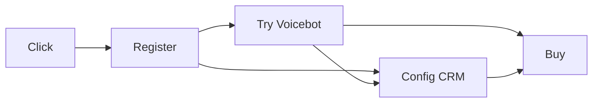

# Tổng quan

- **Sản phẩm**: NT-Voicebot
- **Thị trường ngách**:
  - Đã tiếp cận:
    - Phòng khám nha khoa
    - Showroom nội thất
  - Có thể tiếp cận:
    - Nhà xe
    - Spa
    - ...
- **Selling Point**:
  - Voicebot tự nhiên, chất lượng cao (Đã có)
  - Built-in CRM (đã có cơ bản)
  - Hỗ trợ vận hành bởi AI (chưa có)

# Các phương pháp tiếp cận khách hàng được đề xuất

### 1. "Trải nghiệm cuộc gọi AI trong 1 phút" (**ĐÃ CÓ**)
> **Khách hàng nhập SĐT trên Landing Page → Voicebot AI gọi lại lập tức để họ trực tiếp test chất lượng thoại.**
> 
> Tương đương với việc NT là khách hàng đầu tiên của chính mình, sử dụng voicebot để chăm sóc khách hàng.

### 2. "Freemium, khách hàng trải nghiệm trực tiếp trên Tenant Portal sau khi đăng ký" (**ĐÃ CÓ**)
> **Khách hàng sau khi đăng ký có thể trực tiếp trải nghiệm mà không cần tích hợp vào hệ thống thật của họ.**
>
> Với các template có sẵn, khách hàng có thể trải nghiệm ngay khi bắt đầu sử dụng.

### 3. "Tạo demo, content hướng dẫn cấu hình, sử dụng và đưa lên các nền tảng short-video như Tiktok, FB Reel, Youtube Short" (tốn nguồn lực tạo content)
> Tận dụng kết quả demo, xây dựng template cho từng domain, hướng dẫn sử dụng để tạo ra các short-video. Giúp nhận thị trường có nhận diện về hình ảnh của NT và sản phẩm.

### 4. "Chạy quảng cáo đại trà nhằm xây dựng hình ảnh và nhận diện thương hiệu" (chi phí ~6M VNĐ/tháng)
> Khảo sát thị trường, xem tương tác của thị trường đối với use-case, công nghệ của NT như thế nào

### 5. "Gửi Brochure qua POS tới các khách hàng tiềm năng" (chi phí ~20K VNĐ/1 khách)
> Chủ động tiếp cận các khách hàng tiềm năng. Vấn đề nằm ở chỗ, cần xác định nhóm khách hàng tiềm năng trong khi những thông tin nào khó thu thập.

### 6. "Đặt gian hàng trải nghiệm trực tiếp tại các hội trợ, triển lãm" (chi phí chưa rõ, có thể sẽ cao)
> Tạo hình ảnh nhận diện thương  hiệu tại các hôi trợ, triển lãm. Tuy nhiên chi phí tại mỗi lần tham gia có thể cao và dễ bị lu mờ trước những nhãn hàng lớn, có quầy to/rộng.

### 7. "Referral Program cho các agency, khách hàng giới thiệu khách hàng mới" (chia sẻ lợi nhuận)
> Khi có một lượng khách hàng ban đầu, chiến lược này có thể giúp đẩy mạnh về quy mô phát triẻn.

### 8. Roadmap

- 2026 Oct - 2026 Nov: Đóng gói kịch bản chuẩn, làm Web riêng cho Voicebot và thử nghiệm miễn phí 5-10 cơ sở lấy Case Study.
> Vấn đề chưa tiếp cận được khách hàng do họ chưa phải đối tượng tiềm năng hay do sản phẩm chưa đủ tốt? -> thiếu feedback và kết quả trong quá khứ những tháng qua khiến phase này thiếu căn cứ.
> ==> Cần giải quyết vấn đề cold start của sản phẩm.
- 2026 Dec - 2027 Feb: Chạy Ads "Nhận cuộc gọi AI 10s", Sales trực tiếp tiếp cận 120 cơ sở  tại Hà Nội & TP.HCM.
- 2027 Mar - 2027 Apr: Tổ chức Webinar ngành, mở Referral Program với các công vị phần mềm POS/Dental và bán gói gia hạn.

# Chiến lược Digital Growth
> Tập trung trả lời câu hỏi: "nhóm doanh nghiệp nào có nhu cầu mua Voicebot cao nhất, tìm họ ở đâu và bằng cách nào xác minh nhu cầu đó?"
>

- **Discover**: tìm và phân loại các phân khúc doanh nghiệp có nhu cầu cao.
- **Acquire**: tiếp cận họ thông qua Search, Social, cộng đồng, nội dung và outbound digital.
- **Convert**: đưa khách hàng từ nội dung hoặc quảng cáo đến cuộc gọi demo, Tenant Portal và dùng thử.
- **Learn**: Đo đạc tương tác của khách hàng lên sản phẩm, sử dụng data này để xác định ngành, thông điệp và kênh đáng đầu tư nhất.

### Đo đạc activity của khách hàng

> **CAC** viết tắt của Customer Acquisition Cost, nghĩa là Chi phí thu hút khách hàng
>
> **ICP** là viết tắt của Ideal Customer Profile, nghĩa là Chân dung khách hàng lý tưởng
